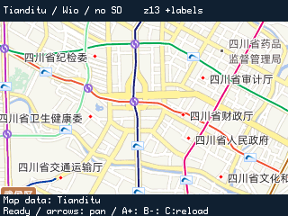

# Wio Terminal 天地图

使用 Wio Terminal 自带的 Wi-Fi 和 320 × 240 屏幕显示真实天地图道路底图与中文注记，支持按键平移、缩放和重新加载。无需 SD 卡，下载与解码均使用有上限的 RAM 缓冲区。

使用原始 `256 × 256` 瓦片像素密度，只请求当前 `320 × 192` 地图区域的可见瓦片，通常 2～4 张、跨边界时最多 6 张。每次仅下载和处理一张，PNG 解码行直接写入屏幕；不保存整张解码瓦片或屏幕帧缓冲。

默认地图中心是成都 `30.6586, 104.0648`，初始缩放为 `13`。这是可配置的固定中心，不是设备定位；本示例没有接入 GNSS、路线规划或导航。

## 硬件和依赖

- Seeed Wio Terminal，板卡选择 `Seeeduino Wio Terminal`，FQBN 为 `Seeeduino:samd:seeed_wio_terminal`。
- 可连接互联网的 Wi-Fi，以及有权调用天地图矢量底图和注记 WMTS 服务的密钥。
- `NICE_GFX`、`NICE_GFX_MAP`。
- Seeed SAMD Boards `1.8.6`。
- RTL8720 无线固件 `2.1.3-coloz-tls12.1`，源码、固件和刷写说明见 [coloz/seeed-ambd-firmware](https://github.com/coloz/seeed-ambd-firmware/blob/master/docs/modern-tls.md)。官方旧版 v2.1.3 未启用天地图所需的 ECDHE-RSA/AES-GCM。
- `Seeed Arduino rpcWiFi` `1.1.0` 及其依赖 `rpcUnified`、`mbedtls`、`FS`、`SFUD`。
- `PNGdec` `1.1.7`、`JPEGDEC` `1.8.4`。实际编译验证使用的官方源码提交分别为 `b862a89409962366fd704ed0445b983a710f034c` 和 `86282979224c8a32fd51e091ed5a35b0c699a52b`。

PNGdec 和 JPEGDEC 可分别从 [bitbank2/PNGdec](https://github.com/bitbank2/PNGdec) 与 [bitbank2/JPEGDEC](https://github.com/bitbank2/JPEGDEC) 获取。Wio 网络固件和库的安装方式参见 [Seeed Wio Terminal Wi-Fi 文档](https://wiki.seeedstudio.com/Wio-Terminal-Wi-Fi/)与[网络概览](https://wiki.seeedstudio.com/Wio-Terminal-Network-Overview/)。本示例不会自动刷写无线协处理器固件。

## 配置

复制 `WioSecrets.example.h` 为同目录的 `WioSecrets.local.h`，填写 Wi-Fi 名称、密码和天地图密钥。该本地文件由库的 `.gitignore` 排除；公开模板不包含真实凭据。如果本地配置已经存在，直接使用即可。

可在本地配置中修改以下地图设置：

| 配置 | 含义 |
| --- | --- |
| `InitialLatitude`、`InitialLongitude` | 初始中心经纬度，WGS84/Web Mercator 对应的地理坐标 |
| `InitialZoom` | 天地图请求的缩放级别 |
| `Labels` | 是否加载 `cva_w` 中文注记 |

密钥需要具备实际使用的服务权限。密钥有效并不等于已经开通对应 WMTS 服务；权限不足时，示例会显示请求失败，不会用虚构地图代替。

`TiandituRootCa.h` 提供本次验证的 GlobalSign Root R3 根证书。HTTPS 使用 CA 校验，不会关闭证书验证。如果服务端以后更换证书链，需要相应更新根证书。

新版无线固件在 TLS 前需要主控初始化。示例通过 NTP 校时，从 SAMD51 硬件 TRNG 取得 64 字节种子，再调用追加的 RPC bootstrap；此流程每三小时刷新，缺少有效种子或时间时拒绝建立 TLS。NTP 是普通网络校时，不提供加密认证。`WioTlsBootstrap.h` 和 `WioSamd51Entropy.h` 与无线固件仓库的 `tools/host` 保持同步，旧版无线固件不会收到新 RPC 方法。

## 操作

屏幕顶部为状态栏，中间为 `320 × 192` 地图区域，底部显示操作提示。

| 操作 | 功能 | 串口命令 |
| --- | --- | --- |
| 五向摇杆上、左、下、右 | 平移地图，每次 64 个显示像素 | `w`、`a`、`s`、`d` |
| 摇杆中键 | 返回配置的初始中心和缩放 | `h` |
| 按键 A，GPIO 28 | 放大一级 | `+` |
| 按键 B，GPIO 29 | 缩小一级 | `-` |
| 按键 C，GPIO 30 | 重新加载当前地图 | `r` |
| 串口 | 开关中文注记并重新加载 | `l` |
| 串口 | 输出版本、网络及 TLS 诊断，并暂停加载 | `t` |
| 串口 | 运行 TLS 证书正反验证，并暂停加载 | `q` |
| 串口 | 输出设备真实屏幕的 RGB888 数据 | `x` |

串口速率为 `115200`。地图采用同步逐瓦片下载和解码，网络请求期间按键响应会暂停；这不是后台并行加载示例。

## 内存取舍

Wio Terminal 的 SRAM 有限，不能直接使用 ESP32 示例的多 MiB 缓存配置。本例采用以下方式控制内存：

1. 按原始 `256 × 256` 像素显示，保留文字大小和颜色；不再缩成 `128 × 128` 后请求多达 12 张瓦片。
2. 联网前一次申请 `48 KiB` 压缩数据缓冲，后续底图、注记和重试重复使用同一块内存，避免大块内存反复申请、收缩和释放造成碎片。底图响应最多 `48 KiB`，注记最多 `24 KiB`；注记的限制不会因缓冲较大而放宽。使用 HTTP/1.1 接收 chunked 响应，下载完成后释放 TLS 客户端再开始解码；超过上限返回 `TooLarge`。
3. 逐行解码到 RGB565，只需最多 `256` 个像素、`512 B` 的行数据；现有 `1 KiB` 绘制/截图工作区重复使用。完全位于屏幕外的行和列不写入 LCD。
4. PNG 解码对象使用约 `45,732 B` 的固定静态工作区，避免连续下载时反复申请大块内存造成碎片。该示例的天地图显示路径只接受 PNG；底图解码完成、压缩数据清空后，注记覆盖同一缓冲。
5. 透明中文注记按可见行从 LCD 读回背景，再做 alpha 合成并写回。完全透明的行直接跳过。没有 `16 KiB` 的 RGB332 工作瓦片，也没有 `32 KiB` 的 RGB565 完整瓦片。

静态工作区已经计入 `.bss`，不能再次作为动态分配相加。主要动态图像内存只有当前一份压缩 PNG；URL、容器、网络对象、分配器和线程栈还会占用内存。

主控静态 RAM 为 `.data 800 B + .hsram 1,024 B + .bss 110,108 B = 111,932 B`，其中包含 Seeed RPC/FreeRTOS 的 `48 KiB` 静态堆及 PNG 工作区；持久压缩数据缓冲的 `48 KiB` 属于动态堆。TLS 运算在 RTL8720 上执行，不在 SAMD51 上另开 TLS 记录缓冲。下载上限不等于任意复杂瓦片都能解码，资源不足仍会明确返回 `NoMemory`。

地图清晰度、加载速度和交互流畅度会低于带 PSRAM 的 ESP32-S3。复杂区域的瓦片可能超过 `48 KiB` 上限；这是纯 RAM 配置的明确限制。可尝试关闭注记、平移或调整缩放，但不保证每个区域都能下载成功。本例不提供持久离线地图包或离线路径搜索。

## 编译

需要 C++17。Seeed SAMD `1.8.6` 默认使用 C++14，并且汇编规则没有指定 CPU；当前 PNGdec/JPEGDEC 中按平台排除的汇编文件在该旧工具链上会产生架构不一致的空对象。因此编译命令同时补上 C++ 标准与汇编目标参数，无需改动平台文件。

在 `D:\Git\GFX` 的 PowerShell 中，使用工作区已有离线工具链编译：

```powershell
& 'C:\Program Files\Arduino IDE\resources\app\lib\backend\resources\arduino-cli.exe' compile --config-file .wio-tools\arduino-cli.yaml --fqbn Seeeduino:samd:seeed_wio_terminal --library D:/Git/GFX/nice_gfx --library D:/Git/GFX/nice_gfx_map --build-property compiler.cpp.extra_flags=-std=gnu++17 --build-property 'compiler.S.extra_flags=-mcpu=cortex-m4 -mthumb' --build-path D:/Git/GFX/.wio-tools/build-map-tianditu nice_gfx_map/examples/15_WioTerminalTianditu
```

如使用其他 Arduino 安装目录，替换 CLI、配置和库路径。不要添加 `--upload`，除非要明确执行烧录。

## 验证范围

2026-10-20 使用 Arduino CLI `1.5.1`、Seeed SAMD `1.8.6` 和上述依赖，实际编译、上传至无 SD 卡的 Wio Terminal 并联网测试。程序空间 `169,192 B`，约占 `507,904 B` 上限的 `33%`；静态 RAM 如上。

初始成都视野完整加载 `2/2` 张瓦片及中文注记，耗时约 `5.5 s`，失败数为 `0`；底图 PNG 分别为 `34,459 B`、`36,086 B`，对应注记为 `4,705 B`、`8,622 B`。TLS 正反检查后重新加载同一视野再次成功，newlib 堆增长保持 `63,960 B`。这个数值包含持久下载缓冲，是分配器堆边界的增长量，不是可用 RAM 或实际活跃对象总量。

真机平移到同时跨越横、纵瓦片边界的视野，完整加载 `6/6` 张底图及对应注记，约 `19.8 s` 完成；放大后 `2/2` 成功，缩小返回、再次重载均 `6/6` 成功，返回初始视野 `2/2` 成功。含开机在内的连续六个视野共完成 24 张底图及对应注记，各视野失败数均为 `0`，newlib 堆增长始终保持 `63,960 B`。这些是短时交互测试，不代表任意区域或长时间稳定性保证。

下图由设备 ILI9341 屏幕逐行读回取得，图像 `320 × 240`，不是桌面地图预览：



原生逐行绘制器的 `1,911` 项主机检查覆盖真实底图/透明注记、裁剪、屏幕行读写错误和越界保护；HTTPS 的 `105` 项检查覆盖响应边界、错误清理与缓冲复用。无线固件的真机 TLS 矩阵全部通过：正确 CA 成功，错误 CA、域名不匹配和错误日期均以 X.509 校验错误拒绝，恢复后连接成功；详见[验证记录](https://github.com/coloz/seeed-ambd-firmware/blob/master/docs/validation.md)。
